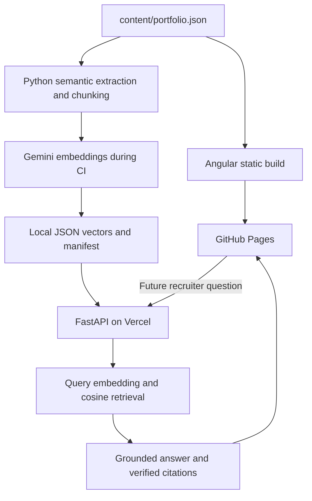

# Application architecture

## Current frontend

The frontend uses Angular 22.3.0 with standalone components, strict TypeScript,
signals, zoneless change detection, and standard hydration. It is built as a static
application; GitHub Pages serves the resulting HTML, CSS, JavaScript, and assets.
No Node or Python process is needed in production for the portfolio UI.

`content/portfolio.json` is the canonical content source. A typed
`PortfolioContentService` imports it during compilation; section components receive
records through signal inputs. Shared JSON Schema and build-time semantic checks
validate content before compilation. Presentation labels can live in templates;
professional facts live in JSON. Detailed content uses safe structured elements
instead of executable HTML strings.

The home page composes header, hero, skills, experience, projects, beyond-code,
education, contact, and footer components. Shared components render links, icons,
headings, and structured text. Native disclosures keep project details accessible.
Browser-only observers handle reveals and reading-section navigation with lifecycle
cleanup and reduced-motion support.

## Routing and hosting

`app.routes.ts` defines `/PortfolioWebApp` as the entry route. Empty URLs, unknown
routes, and invalid project slugs redirect there. Project pages use
`/PortfolioWebApp/projects/:slug` and are generated from the same JSON records.

The router uses `APP_BASE_HREF: /` so it matches the complete path. The production
HTML base href remains `/PortfolioWebApp/` to locate bundles and media at the
existing Pages URL. Keeping these purposes separate prevents doubled prefixes.
Development uses an HTML base of `/` and the same explicit Angular routes.

The build prerenders the home page and each project page, then creates `404.html`
and `.nojekyll`. Known deep links load directly on Pages; unmatched requests can
bootstrap the router through the fallback. An unknown initial request still has
HTTP 404 status until browser routing redirects it.

Assets live in `frontend/src/assets/` and are copied directly by Angular. The
global style entry imports `frontend/src/styles/portfolio.css`. The build generates
head metadata from the shared profile. CSP-compatible standard hydration avoids
unused inline incremental-hydration bootstrap scripts.

## API foundation

`ApiService` wraps Angular HttpClient/fetch with configurable base URL, timeout,
and consistent errors. `ChatbotService` defines future health/chat calls with typed
requests, answers, and citations. The app makes no backend requests on startup.
Local and production environment files contain public configuration; provider
credentials must stay on the future backend.

## Delivery

The frontend is a standalone npm project with its own `package.json`, lockfile,
`node_modules`, Node/formatter configuration, and build helpers under `frontend/`.
Its scripts validate shared content, prepare metadata, build Angular, and prepare
Pages files under `frontend/dist/portfolio/browser/`. The backend remains a
separate uv project. A local static preview serves only
the build output. Pull requests run build CI. Main pushes run a build followed by
Pages deployment; the deploy job depends on successful build/artifact creation.
Workflows run npm from `frontend/` and cache its lockfile. Remote Pages must use
GitHub Actions as its publishing source.

## Current backend skeleton

`backend/app/main.py` creates a FastAPI application with separate chat and ingestion
route modules, Pydantic request/response models, environment-backed CORS settings,
and interactive OpenAPI documentation. `POST /api/chat` validates a question and
returns a static answer/empty citations; `POST /api/ingest` explicitly reports a
stub response and no index update. These are the only two application endpoints
for this phase; no health route, pipeline, model calls, or job queue is implemented.

The backend is a uv project: `backend/pyproject.toml` defines dependencies and
`dev`/`start` console commands, `uv.lock` locks the complete dependency graph, and
`.python-version` pins Python 3.14. uv installs the existing `app/` package in
editable mode. `uv run dev` starts Uvicorn with application reloads; `uv run start`
runs without reload. The local `.venv` is managed automatically and ignored by Git.
No AI credentials are
needed. Its CORS defaults cover both local Angular development origins; `.env`
configuration can override them. The frontend and backend are not wired into a
chat UI yet. See `backend/README.md` for local setup and endpoint examples.

## Later backend and RAG phases

The ingestion/index directories remain placeholders. The intended completed flow:

For the small portfolio dataset, start with a JSON vector index and cosine
similarity. Preserve stable document/chunk IDs, source sections/URLs, content hashes,
model/dimension metadata, and an index manifest. Build the index before deployment,
bundle it read-only with FastAPI, and validate the deployed content revision before
publishing the matching frontend. Runtime chat must not rebuild the index.

Later work includes private optional LangSmith tracing, recruiter chat UI, provider
configuration, and operational limits. Model/runtime/free-tier choices need fresh
verification in those phases. Unit/end-to-end tests and RAG evaluations remain
deferred until after the working MVP, as requested.

Manual ingestion and trusted CI should share one pipeline entry point. CI will
run it when `content/**` changes and package its exact index revision with the
backend. The production manual fallback needs owner authorization and a durable
build/deployment path; serverless local writes cannot persistently replace a
bundled index. This wiring is deferred until the ingestion phase.
