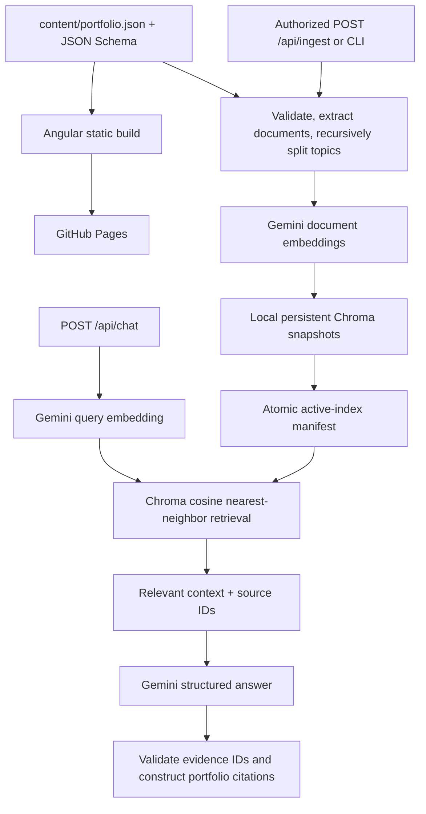

# Application architecture

## Current frontend

The frontend uses Angular 22.3.0 with standalone components, strict TypeScript,
signals, zoneless change detection, and standard hydration. It is built as a static
application; GitHub Pages serves the resulting HTML, CSS, JavaScript, and assets.
No Node or Python process is needed in production for the portfolio UI.

`content/portfolio.json` is the canonical content source. A typed
`PortfolioContentService` imports it during compilation; section components receive
records through signal inputs. Shared JSON Schema and build-time semantic checks
validate content before compilation. Presentation labels can live in templates;
professional facts live in JSON. Detailed content uses safe structured elements
instead of executable HTML strings.

The home page composes header, hero, skills, experience, projects, beyond-code,
education, contact, and footer components. Shared components render links, icons,
headings, and structured text. Native disclosures keep project details accessible.
Browser-only observers handle reveals and reading-section navigation with lifecycle
cleanup and reduced-motion support.

## Routing and hosting

`app.routes.ts` defines `/PortfolioWebApp` as the entry route. Empty URLs, unknown
routes, and invalid project slugs redirect there. Project pages use
`/PortfolioWebApp/projects/:slug` and are generated from the same JSON records.

The router uses `APP_BASE_HREF: /` so it matches the complete path. The production
HTML base href remains `/PortfolioWebApp/` to locate bundles and media at the
existing Pages URL. Keeping these purposes separate prevents doubled prefixes.
Development uses an HTML base of `/` and the same explicit Angular routes.

The build prerenders the home page and each project page, then creates `404.html`
and `.nojekyll`. Known deep links load directly on Pages; unmatched requests can
bootstrap the router through the fallback. An unknown initial request still has
HTTP 404 status until browser routing redirects it.

Assets live in `frontend/src/assets/` and are copied directly by Angular. The
global style entry imports `frontend/src/styles/portfolio.css`. The build generates
head metadata from the shared profile. CSP-compatible standard hydration avoids
unused inline incremental-hydration bootstrap scripts.

## API foundation

`ApiService` wraps Angular HttpClient/fetch with configurable base URL, timeout,
and consistent errors. `ChatbotService` defines future health/chat calls with typed
requests, answers, and citations. The app makes no backend requests on startup.
Local and production environment files contain public configuration; provider
credentials stay on the backend. Production points at the stable Vercel origin
`https://portfolio-web-app-six-sage.vercel.app/api`.

## Delivery

The frontend is a standalone npm project with its own `package.json`, lockfile,
`node_modules`, Node/formatter configuration, and build helpers under `frontend/`.
Its scripts validate shared content, prepare metadata, build Angular, and prepare
Pages files under `frontend/dist/portfolio/browser/`. The backend remains a
separate uv project. A local static preview serves only
the build output. Pull requests run build CI. Main pushes run a build followed by
Pages deployment; the deploy job depends on successful build/artifact creation.
Workflows run npm from `frontend/` and cache its lockfile. Remote Pages must use
GitHub Actions as its publishing source.

## Current backend and RAG

`backend/` is an independent Python 3.14 uv project. FastAPI exposes two business
endpoints: public `POST /api/chat` and owner-token-protected `POST /api/ingest`.
Console commands expose the same pipeline as `uv run ingest`, `ask`, `retrieve`,
and `inspect-index`; `ingest --dry-run` needs no provider credentials.

The loader extracts factual profile, skills, roles, project summaries/details,
education, and personal information from the existing content model. Recursive
splitting stays within source document boundaries. Chunks retain deterministic
IDs and source metadata, including real project-page/section citation URLs.
Gemini document/query task types and dimensions are explicit. Chroma has no
implicit embedding function or separate server.

Ingestion reuses compatible unchanged embeddings, builds a new collection without
removed chunks, validates it, and atomically publishes a manifest only on success.
A filesystem lock serializes local CLI/API ingestion. Previous snapshots remain
available to in-flight readers. The manifest records source/configuration hashes,
embedding model/dimensions, counts, chunk IDs checksum, timestamp, and CI revision.
Chat checks compatibility/freshness before retrieval and never builds an index.

Generation receives only retrieved evidence and grounding instructions. Gemini
returns structured text and evidence IDs; the backend rejects IDs outside the
retrieved context and constructs citation URLs from trusted source metadata.
Each citation also names all supporting chunk IDs. `retrieved_chunks` returns the
exact context text, source metadata, cosine similarity, and a flag indicating
whether the model cited each chunk. This prepares a future citation evidence panel
without additional API calls or losing the original response's content snapshot.
Insufficient information returns a clear fallback. Questions and model output are
bounded, provider errors use safe responses, and ingestion requires an owner token.
These mechanisms do not prove every generated claim; manual answer review is still
needed. Production rate limiting remains later work. Optional private LangSmith tracing
is implemented for ingestion, retrieval, embeddings, and Gemini generation,
including returned root trace IDs. Tracing uses explicit whitelisted inputs and
never publishes trace links or credentials.

## Index automation and Vercel releases

`ingest.yml` runs only for trusted main pushes affecting content/backend ingestion
or through manual dispatch. It uses a repository Gemini secret, locked uv installs,
a previous-index cache for embedding reuse, and an explicit index validation step.
Packaging compacts the active collection and includes the matching JSON/schema,
index manifest, and release checksums in a commit-specific artifact. A dependent
deployment job verifies the downloaded bytes and revision before the official
Vercel CLI uploads the code and snapshot for a Linux cloud build.

Production candidates use `--prod --skip-domain` so the current aliases remain in
place. Hosted health must identify the packaged revision, and one real Gemini
answer must contain valid evidence chunks, before promotion. A public health check
then confirms the stable alias serves that revision. Project configuration keeps
production aliases public, protects previews/unique URLs, and disables direct Git
deployments that would omit ingestion artifacts.

Cold startup verifies the bundle and copies Chroma to a per-release directory in
`/tmp`; only that writable copy is opened. No model calls run on startup. Each
instance uses the same immutable content/index snapshot. Durable refreshes rebuild
and redeploy through a main push or manual workflow dispatch. Hosted `/api/ingest`
returns 409 with these directions; local authenticated ingestion remains available.

The GitHub artifact is consumed during deployment, never downloaded by the API.
Local databases remain independent. Native dependency size/runtime compatibility
are checked by the Vercel build and hosted verification. Existing frontend Pages
workflows remain independent; coordinating frontend/backend releases is later work.

See [backend setup, APIs, commands, and secrets](../backend/README.md).
Automated suites and RAG evaluations remain deferred until after the working MVP.
